<div align="center">
  
</div>

<br>

<div align="center">
  
</div>

<br>

<div align="center">
  
</div>

<br>

**[Selly](https://sellycrm.de) – ein CRM, das kein Projekt ist.**

> **GiG – GeSaast is Geil.**

---

```yaml
# ~/.config/nabez/stack.yml

languages:  [Rust, SQL, TypeScript, CSS]
frontend:   [Leptos, WebAssembly]             # average enjoyer
backend:    [Axum, tokio, sqlx, PostgreSQL]
infra:      [Server in DE, Docker, Caddy, GitHub Actions]
ai:         [Ollama]                          # self-hosted, bleibt im Haus
```

---

#### `> wc -l selly/**` · XXL-Portion, keine halben Sachen

```text
1.129.958 Zeilen in 7.290 Dateien

Rust         916.437   5.801 Dateien   ████████████████████████░░░░░░  81 %
CSS           72.579     473 Dateien   ██░░░░░░░░░░░░░░░░░░░░░░░░░░░░   6 %
TypeScript    50.451     337 Dateien   █░░░░░░░░░░░░░░░░░░░░░░░░░░░░░   4 %
SQL           24.118     269 Dateien   █░░░░░░░░░░░░░░░░░░░░░░░░░░░░░   2 %
──────────────────────────────────────────────────────────────────────
10.453 Tests · 294 E2E-Specs · 261 Migrationen · 45 Crates · 1 Binary
```

#### `> cargo test echte_probleme`

```text
running 9 tests
test dashboard_tickt_live_ohne_f5 .................. ok
test dashboard_laeuft_aufm_buero_tv ................ ok
test eine_million_kontakte_liste_in_5_ms ........... ok
test so_viele_server_wie_de_willst ................. ok
test prod_umzug_in_46_sekunden ..................... ok
test videocall_ohne_zoom_und_teams ................. ok
test zehn_leute_eine_liste_keiner_ruft_doppelt ..... ok
test push_aufs_iphone_ohne_app_store ............... ok
test kunde_a_sieht_nie_die_daten_von_kunde_b ....... ok

test result: ok. 9 passed; 0 failed; 0 ignored
```

<details>
<summary><b>Und wie genau?</b></summary>
<br>

- **Dashboard tickt live, ohne F5** – jede Änderung im CRM geht per WebSocket an alle Bildschirme des Mandanten, ein `tokio::broadcast`-Kanal je Mandant. Deal gewonnen, Kachel springt um – bei allen, sofort.
- **Dashboard aufm Büro-TV** – ein Dashboard read-only an die Wand. Im CRM gibt's Adresse und Code, der Fernseher tippt ihn ein. Kein Login am Gerät, freigegeben wird im CRM.
- **1 Mio Kontakte, Liste in 5 ms** – Stresstest mit 1,05 Mio Kontakten und 9,76 Mio Zeilen: Kontaktliste 4,7 ms, Profil 1,4 ms, Feeds aus Tabellen mit 2–3 Mio Zeilen in 1–4 ms.
- **So viele Server wie de willst** – ein Binary, beliebig oft starten. Alle bedienen Oberfläche und API, die Hintergrund-Jobs fährt genau einer (Postgres-Advisory-Lock). Stirbt der, übernimmt der nächste – automatisch.
- **Prod-Umzug in 46 Sekunden** – neuer Server: einfrieren, Dump, rüber, einspielen, hochfahren. 46 Sekunden, Zeilen gegengezählt, Prüfsumme gleich.
- **Videocall ohne Zoom und Teams** – Selly Meet: jeder Termin hat seinen eigenen Videoraum, der Kunde kommt per Link ohne Konto rein und wartet in der Lobby. WebRTC, eigener TURN-Server.
- **Zehn Leute, eine Liste, keiner ruft doppelt** – Kaltakquise im Team: wer einen Kontakt zieht, hält ihn 10 Minuten exklusiv (Claim-Lease in Postgres). Ohne Lebenszeichen geht er zurück in die Liste.
- **Push aufs iPhone, ohne App Store** – Web Push mit VAPID und aes128gcm, selbst gebaut. Läuft auf Mac, iPhone (als Home-Bildschirm-App) und Apple Watch.
- **Kunde A sieht nie die Daten von Kunde B** – Row-Level-Security mit FORCE auf 210 von 225 Tabellen, dazu Fremdschlüssel über `(tenant_id, id)`. Ein Verweis auf fremde Daten lässt sich physisch nicht einfügen.

</details>

---

#### `> ls Selly-CRM/`

▸ **selly** — das Produkt: Multi-Tenant-CRM, ein Binary, 45 Crates · [sellycrm.de](https://sellycrm.de)

▸ **selly-web** — die Website: statisch, ohne JavaScript, ohne fremde Server

---

<div align="center">
  <picture>
    <source media="(prefers-color-scheme: dark)" srcset="https://raw.githubusercontent.com/Nabez/Nabez/output/schlange-dunkel.svg" />
    
  </picture>
</div>

---

<div align="center">

  [sellycrm.de](https://sellycrm.de) · [GitHub](https://github.com/Nabez)

  

</div>
